  

Estou aprendendo desenvolvimento web construindo projetos reais — sites, sistemas e automações. O código está abaixo, com demo quando o projeto está no ar.

## Stack

**Frontend**  
   

**Backend**  
    

**Dados e ambiente**  
   

## Projetos

###  [Associação de Artesãos de Caxias](https://github.com/felipeserejo/Associacao-de-Artesaos-de-Caxias)

Site institucional, painel administrativo e gestão de pedidos. **39 migrations, 21 controllers, 19 models e mais de 75 views** em Laravel 12 + PostgreSQL. · [Landing page no ar](https://felipeserejo.github.io/artesanato-landing-page/)

*Projeto Integrador Extensionista — UniFacema*

###  [Organização Estudantil](https://github.com/felipeserejo/Sistema_de_Organizacao_Estudantil)

Sistema para organizar aulas, trabalhos e provas, com dashboard, CRUD completo, calendário acadêmico e gerador de capa ABNT. · [Demo no ar](https://sistema-de-organizacao-estudantil.vercel.app/)

*MVP — Certificação Intermediária em Programação Front-End — UniFacema (2026)*

###  [Farmácia Bem-Estar](https://github.com/felipeserejo/farmacia-bem-estar)

API REST com interface web para cadastro e gerenciamento de farmácia: **10 tabelas, CRUD completo, registro de vendas e documentação MER/DER**.

*TDE — Programação em Banco de Dados — UniFacema*

###  [Sistema de Reservas](https://github.com/felipeserejo/sistema-reservas-restaurante)

Reserva de mesas para restaurantes, com **modelagem orientada a objetos** e persistência em SQLite.

*TDE — Análise e Projeto Orientado a Objetos — UniFacema*

###  [Backup Orchestrator](https://github.com/felipeserejo/backup-orchestrator)

Orquestrador full-stack para **automação e sincronização de backups** de bancos de dados self-hosted e cloud no Google Drive.

## GitHub

  <picture>
    <source media="(prefers-color-scheme: light)" srcset="https://github-profile-summary-cards.vercel.app/api/cards/profile-details?username=felipeserejo&theme=default">
    
  </picture>

## Aprendendo agora

- [x] **Next.js e SQL** — aplicados no projeto Organização Estudantil
- [x] **Linux e automação** — scripts de backup e rotina
- [ ] **Cibersegurança** — estudando fundamentos
