  

Estou aprendendo desenvolvimento web construindo projetos reais — sites, sistemas e automações.

Trabalho em duas frentes: sistemas completos de ponta a ponta e ferramentas que resolvem um problema meu do dia a dia.

## Stack

**Frontend**  
   

**Backend**  
    

**Dados e ambiente**  
   

## Projetos

### Sistemas completos

Sistemas de ponta a ponta — banco modelado, regras de negócio, interface.

####  [Associação de Artesãos de Caxias](https://github.com/sshs3rejo/Associacao-de-Artesaos-de-Caxias)

Site institucional, painel administrativo e gestão de pedidos para uma associação real de artesãos. **39 migrations, 21 controllers, 19 models e mais de 75 views** em Laravel 12 + PostgreSQL.

Projeto Integrador Extensionista, UniFacema — a primeira versão foi uma landing page em HTML puro, depois substituída por este sistema

####  [Organização Estudantil](https://github.com/sshs3rejo/Sistema_de_Organizacao_Estudantil)

Agenda acadêmica com dashboard, CRUD completo, calendário de aulas, trabalhos e provas — e gerador de capa ABNT para entrega dos trabalhos.

**[Abrir o sistema no ar](https://sistema-de-organizacao-estudantil.vercel.app/)** · MVP, UniFacema (2026)

####  [Farmácia Bem-Estar](https://github.com/sshs3rejo/farmacia-bem-estar)

Gestão de farmácia em Node.js + Express + MySQL: **10 tabelas**, CRUD completo, registro de vendas e documentação MER/DER.

Estoque controlado **por lote com validade**, não por contador único — o que é obrigação sanitária de farmácia e foi a decisão de modelagem mais importante do projeto.

####  [Sistema de Reservas](https://github.com/sshs3rejo/sistema-reservas-restaurante)

Reservas de mesa para restaurantes em C# (.NET 8): herança, classe abstrata, interface e persistência em SQLite, com diagramas de classe e caso de uso versionados em Mermaid.

### Ferramentas

Projetos que resolvem um problema concreto do meu ambiente.

####  [Backup Orchestrator](https://github.com/sshs3rejo/backup-orchestrator)

Painel para orquestrar backups de bancos self-hosted e cloud no Google Drive via rclone. Cadastro de bancos e destinos, agendamento, histórico de execuções com status e tamanho — no lugar de um `pg_dump` esquecido no crontab.

Next.js 16 · Prisma 7 · PostgreSQL

## Contribuições

  <picture>
    <source media="(prefers-color-scheme: dark)" srcset="https://raw.githubusercontent.com/sshs3rejo/sshs3rejo/main/output/pacman-contribution-graph-dark.svg">
    <source media="(prefers-color-scheme: light)" srcset="https://raw.githubusercontent.com/sshs3rejo/sshs3rejo/main/output/pacman-contribution-graph.svg">
    
  </picture>

## Estudando agora

**Cibersegurança** — fundamentos. Próximo passo depois de fechar os projetos em aberto.

## Como este perfil funciona

O banner e o gráfico de contribuições são gerados por GitHub Actions a cada 6 horas. Os números do fastfetch — repositórios, seguidores e contribuições — vêm da API do GitHub no momento da geração, e o SVG resultante fica versionado neste repositório. Nenhuma imagem do perfil depende de um serviço de terceiros no ar.
